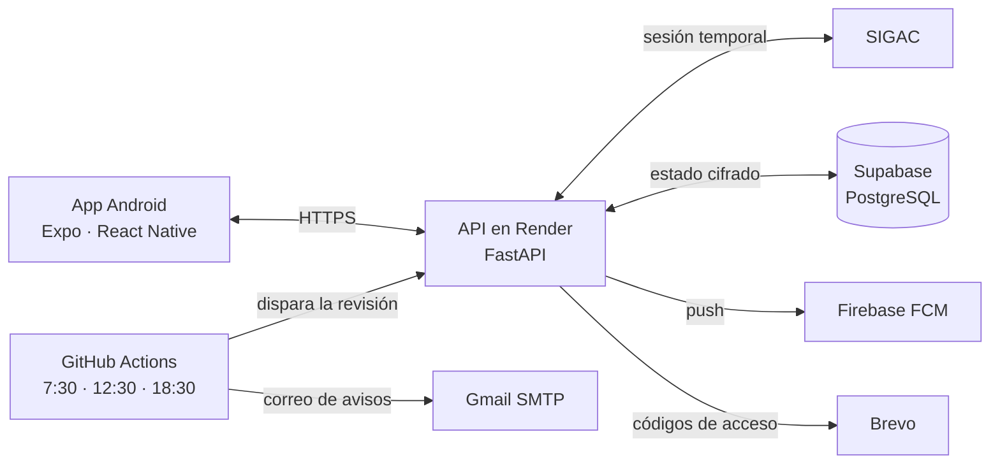

# Tinotify

**Avisos de novedades de SIGAC para estudiantes y asesores del Consultorio Jurídico.** Tinotify revisa tu cuenta de SIGAC tres veces al día y te avisa
—por notificación y por correo— cuando hay una actuación o un expediente nuevo, diciéndote en qué radicado, en qué etapa y en qué sentido
(`ASESOR → ESTUDIANTE`, `DIRECCIÓN → ESTUDIANTE`…). Todo lo sensible se guarda cifrado.

[](https://github.com/JuanMa1015/Tinotify/actions/workflows/backend-tests.yml)

> **Tinotify es un proyecto independiente.** No está afiliado a SIGAC ni a la Universidad de Antioquia, ni cuenta con respaldo o autorización
> institucional. Los avisos son una ayuda: confirma siempre en el sistema oficial. **Estado: beta cerrada** (acceso solo por invitación).

## Qué hace

- **Seguimiento automático.** Revisa tu cuenta a las 7:30, 12:30 y 18:30 (hora de Bogotá) y compara cada expediente con la revisión anterior.
- **Avisos con contexto.** Notificación push y correo con el radicado, la etapa y el sentido de cada actuación nueva.
- **Novedades.** Una pestaña con solo lo nuevo, agrupado por día, con el detalle de cada actuación.
- **Casos.** Tus expedientes con estado, búsqueda y filtros; actuaciones en vivo y descarga de anexos.
- **Acceso sin contraseñas.** Registro por invitación y entrada con un código de 6 dígitos que llega a tu correo (que además lo verifica). Huella o rostro para abrir la app.
- **Administración.** Panel para invitar personas, suspender cuentas, dar administración, vaciar datos y eliminar cuentas, sin ver nunca claves ni contenido.

## Cómo funciona



1. Una persona se registra con una invitación y conecta su usuario y clave de SIGAC. Se guardan **cifrados** (AES-256-GCM); la llave solo existe en la configuración del servicio.
2. Cada revisión inicia sesión en SIGAC por ella, lee sus expedientes y calcula una **huella con clave** de cada actuación. La **novedad** es lo que aparece respecto a la revisión anterior.
3. La primera revisión es una línea base silenciosa: lo que ya existía no se anuncia.
4. Si hay novedades, se crea un aviso: push inmediato y correo en el siguiente ciclo. El texto de la actuación no viaja en el aviso.

## Privacidad y seguridad

- Las credenciales de SIGAC, el listado de expedientes, las fichas de actuaciones nuevas y el correo se guardan **cifrados**; las huellas usan HMAC con clave. Las fichas se conservan 90 días.
- Sin contraseñas propias: el correo se verifica con un código de un solo uso (15 minutos, 5 intentos, 3 por hora).
- Cada persona ve solo lo suyo. El panel de administración muestra estados y conteos, **nunca** claves de SIGAC ni expedientes.
- La base de datos tiene RLS forzado y acceso cerrado a los clientes de Supabase; la API entra con un login de privilegios mínimos.
- La app guarda su sesión en el almacén seguro de Android y nunca guarda tu usuario ni tu clave de SIGAC.

Detalle en [seguridad](docs/security.md), en la [política de tratamiento de datos](docs/legal/politica-tratamiento-datos.md) y en el
[consentimiento](docs/legal/consentimiento-en-app.md). No se deben incorporar credenciales, cookies, HTML reales ni datos de personas al repositorio,
las pruebas, los logs ni los reportes de errores.

## Estructura del repositorio

```text
tinotify/
├── backend/                      # API y monitor (Python 3.11, FastAPI)
│   ├── src/tinotify/
│   │   ├── real_remoto/          # Servicio en producción: rutas, cuentas, monitor, cifrado, push, correo
│   │   ├── integrations/sigac/   # Cliente de SIGAC (sesión temporal, lectura validada)
│   │   ├── parsers/ domain/ services/ persistence/
│   │   └── demo/ api/            # Demostración y API mínima heredadas (casi sin uso en producción)
│   ├── scripts/                  # Ciclo de revisiones, verificaciones y herramientas manuales
│   └── tests/                    # Más de 2000 pruebas con datos ficticios
├── mobile/                       # App Android (Expo SDK 58 · React Native · TypeScript)
├── supabase/
│   ├── propuestas/               # Migraciones del esquema tinotify_real (alta y baja)
│   └── checks/                   # Validación contra PostgreSQL 17 desechable (Docker)
├── docs/                         # Documentación técnica, operativa y legal
├── .github/workflows/            # Pruebas, revisiones programadas, ping y compilación del APK
└── render.yaml                   # Valores de referencia del servicio en Render
```

## Desarrollo

### Backend

Requiere Python 3.11. Desde la raíz:

```powershell
py -3.11 -m venv .venv
.\.venv\Scripts\python.exe -m pip install --require-hashes --only-binary=:all: -r backend/requirements-dev.txt -r backend/requirements-build.txt
.\.venv\Scripts\python.exe backend/scripts/install_local.py
.\.venv\Scripts\python.exe -m pytest
```

Las dependencias se instalan con hashes verificados. Las pruebas usan datos ficticios y transportes simulados: no necesitan credenciales ni acceso a SIGAC.
Las pruebas contra PostgreSQL real corren en Docker y no tocan Supabase: `bash supabase/checks/validar_cuentas_real_python.sh`.

### App móvil

Requiere Node.js 22. Desde `mobile/`:

```powershell
npm ci
npm run typecheck
npm test
npx expo export --platform android --output-dir exportaciones/bundle   # comprueba que el bundle compila
```

Las notificaciones push y el acceso nativo necesitan una *development build* (no funcionan en Expo Go).

## Despliegue y lanzamientos

| Qué | Dónde | Guía |
| --- | --- | --- |
| API | Render, desde `main` | [Despliegue y operación](docs/despliegue-real-remoto-render.md) |
| Base de datos | Supabase, migraciones a mano | [Despliegue y operación § 3](docs/despliegue-real-remoto-render.md#3-base-de-datos-supabase) |
| App Android | APK compilado por GitHub Actions y publicado en *Releases* | [Cómo lanzar una versión](docs/lanzamiento.md) |

Cada cambio entra por *pull request*: pruebas del backend en Linux y Windows y análisis de Sonar deben estar en verde.

## Documentación

| Tema | Documento |
| --- | --- |
| Despliegue, operación y solución de problemas | [despliegue-real-remoto-render.md](docs/despliegue-real-remoto-render.md) |
| Lanzar una versión de la app | [lanzamiento.md](docs/lanzamiento.md) |
| Cuentas, invitaciones y sesiones | [multiusuario.md](docs/multiusuario.md) |
| Notificaciones push | [notificaciones-push.md](docs/notificaciones-push.md) |
| Almacén del monitor en Supabase | [monitor-real-supabase.md](docs/monitor-real-supabase.md) |
| Seguridad | [security.md](docs/security.md) |
| Arquitectura | [architecture.md](docs/architecture.md) |
| Reconciliación y contratos de identidad | [reconciliacion.md](docs/reconciliacion.md) · [contratos-identidad.md](docs/contratos-identidad.md) |
| Política de datos, términos y consentimiento | [docs/legal](docs/legal) |

El resto de los archivos de `docs/` conserva el historial de diseño y validación de las etapas anteriores del proyecto.

## Estado y próximos pasos

La versión **0.1.0** es una beta cerrada. Pendiente: revisión legal de la política y los términos por una persona abogada, dominio propio para el correo,
recuperación del acceso si se pierde el correo, alertas externas si el servicio o las revisiones dejan de funcionar y, más adelante, publicación en tiendas.
Los cambios de la app se registran en [mobile/CHANGELOG.md](mobile/CHANGELOG.md).

## Contribuciones y licencia

Los cambios de comportamiento deben incluir pruebas con datos ficticios y explicar su impacto sobre la privacidad. No adjuntes sesiones ni datos reales para
reproducir fallos; consulta [seguridad](docs/security.md) antes de reportarlos.

La licencia está pendiente de decisión: por ahora no se otorgan derechos de uso, copia ni distribución sobre el código. Una futura licencia no otorgará
derechos sobre SIGAC, marcas institucionales ni expedientes.
