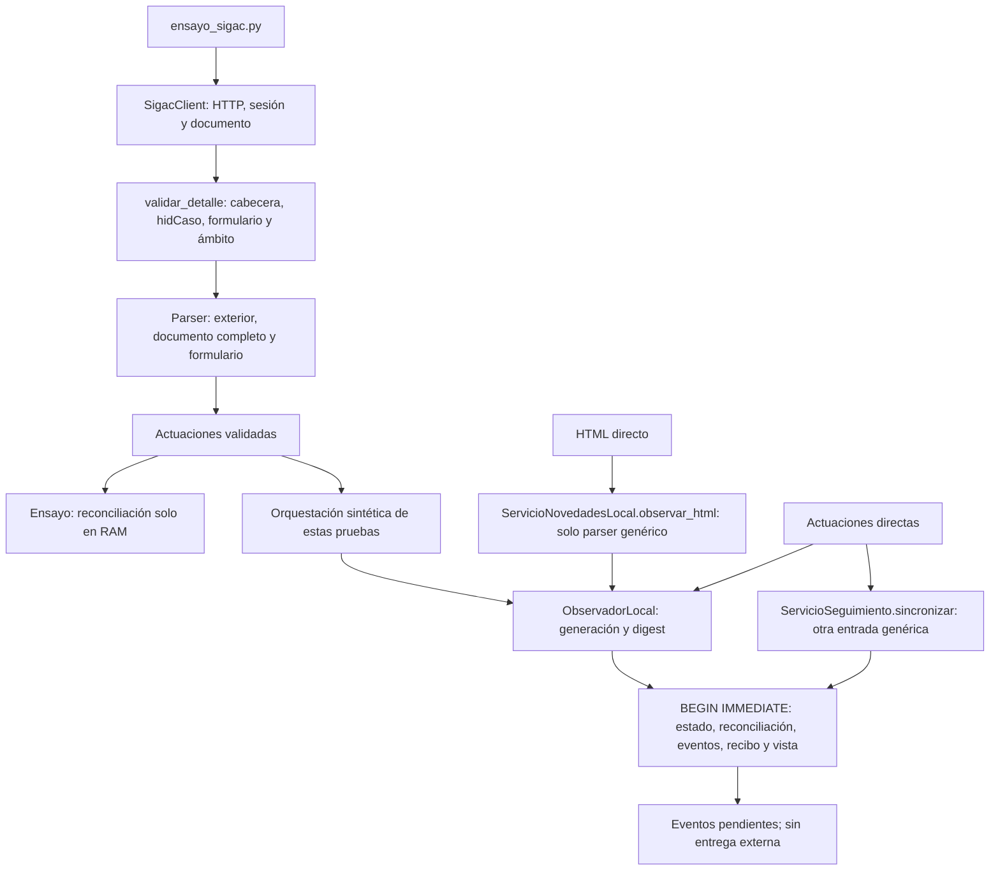

# Auditoría del recorrido SIGAC y SQLite v2

Nota posterior: los bloqueos descritos abajo corresponden al estado auditado.
La corrección autorizada se documenta en `frontera-escritura-sigac.md`; las cuatro
regresiones se conservan y ahora deben aprobar. Los resultados siguientes son
históricos, no la última ejecución tras esa corrección.

Alcance: código local y datos sintéticos; cero SIGAC real, servicios remotos,
instalaciones o bases del usuario. No habilita monitorización. Los resultados
sintéticos no demuestran completitud ni identidad institucional independiente.

## Flujo encontrado

El arco de actuaciones validadas a SQLite se ejecutó mediante pruebas, no mediante
monitorización real. `consulta_real_local.consultar_expediente` está cerrado;
`sigac_local.py consultar/monitorear` termina antes de credenciales/conexión/escritura.
`monitor_local.monitorear` bloquea un `SigacClient` con servicio de perfil real.

## Evidencia por componente

| Archivo / función | Comprobación y límite |
| --- | --- |
| `integrations/sigac/sigac_client.py`, `consultar_historial` | Pertenencia al listado; llama a `validar_detalle` antes de devolver actuaciones. `SigacIdentityError` es la rama de rechazo, no un requisito de éxito. |
| `integrations/sigac/sigac_identidad.py`, `validar_detalle` | Concordancia de marcadores y ámbito; no demuestra independencia de las señales. |
| `parsers/parser.py`, `parse_actuaciones` | Conserva orden y multiplicidad, valida bloques y anexos; rechaza estructuras ambiguas reconocidas. No verifica identidad de expediente por sí solo. |
| `parsers/diagnostico_historial.py` | Catálogos y estadísticas seguros; el diagnóstico no constituye un certificado de completitud. |
| `services/ensayo_sigac.py`, `ejecutar_ensayo` | Usa el cliente y reconcilia en RAM; no abre SQLite. El motor puro admite ausencias como observaciones parciales, no como eliminaciones. |
| `services/reconciliacion.py`, `reconciliar` | Primera base sin eventos, emparejamiento exacto con multiplicidad, conserva identidades ausentes y clasifica ambigüedades. |
| `services/observacion_local.py`, `ObservadorLocal.observar` | Digest, recibo y generación bajo transacción; rechaza ausencias respecto del estado autoritativo. Acepta actuaciones sin procedencia HTTP acreditada. |
| `demo/novedades.py`, `observar_html` / `observar` | Entradas directas sin validación de identidad, también con perfil real. |
| `services/seguimiento.py`, `sincronizar` | Entrada alternativa: no exige identidad SIGAC, digest v2 ni generación esperada del llamador. |
| `persistence/sqlite_local.py`, `transaccion` / `confirmar` | Bloqueo de escritor, rollback, FK y vista mínima atómica. Repositorio genérico: no valida HTML ni identidad institucional. |
| `services/monitor_local.py`, `monitorear` | Guarda real cerrada, HTTP antes de escritura; condición basada en tipo de cliente y perfil, no una prueba transportada por las actuaciones. |
| `services/consulta_real_local.py`, `consultar_expediente` | Siempre rechaza la entrada persistente antigua por posición. |
| `services/sigac_service.py`, `SigacService.procesar` | Ruta antigua offline: parser de listado permisivo y parser de historial sin identidad; puede alimentar al monitor JSON. No acredita SQLite v2 ni una integración real habilitada. |

Las rutas opcionales de sesión local de la API no equivalen a escritura directa
de historial: el gestor predeterminado pasa por el monitor y su guarda real.
Su existencia no permite describir toda esa API como exclusivamente de lectura.
No se activó ni probó contra SIGAC durante esta auditoría.

## Bloqueos confirmados

**Crítico para habilitar seguimiento real:** no existe una frontera obligatoria de
validación SIGAC en todas las entradas de escritura del perfil real. Tres pruebas
exigen rechazo y fallan porque el código acepta HTML contradictorio, actuaciones
directas y sincronización genérica. La reproducción en archivos temporales confirmó
generación 1 y un recibo en los tres casos. No es evidencia de acceso remoto sin
autorización: es una brecha de contrato dentro de la biblioteca local. Las guardas
de las herramientas reales siguen cerradas.

**Alto para uso de la interfaz genérica sobre SQLite v2:**
`ServicioSeguimiento.sincronizar` deja un recibo sin digest y acepta la misma clave
con otro lote como repetición. Una cuarta regresión exige conflicto y falla.
La ruta recomendada `ObservadorLocal` sí verifica digest y generación; no trasladar
sus garantías automáticamente a la otra interfaz. Esta última también carece de
la precondición explícita de generación y del rechazo conservador de ausencias del
observador local. No se corrigió modificando el reconciliador ni el esquema.

Cerrar estas vías requiere decidir el contrato de escritura del perfil real y el
uso admitido de la interfaz genérica. Cambiar esos contratos o comportamiento
requiere aprobación adicional. No se modificó código funcional ni se migraron datos.
Las cuatro regresiones permanecen rojas: sin `xfail`, omisiones o relajación.

## Ensayo real anterior: límite de evidencia

La prueba sintética de la entrada CLI actual confirmó dos llamadas al validador,
nueve solicitudes simuladas y ninguna apertura SQLite. Eso acredita el código
actual en ese entorno, no qué código ejecutó un ensayo real pasado. No consta
evidencia contemporánea suficiente para atribuir el nuevo validador a una ejecución
histórica: un resumen de cantidades o hashes comprobados antes no lo demuestra.
La continuidad entre sesiones no consultaba historiales.

## Pruebas y matriz funcional

Antes de editar: 666 pruebas focalizadas aprobadas. Se reutilizaron identidad,
flujo HTTP, parser, integridad, continuidad y las 37 pruebas SQLite v2.

Nuevas pruebas funcionales en `test_recorrido_sigac_sqlite_v2.py` y proceso auxiliar
`helpers/recorrido_sigac_sqlite_worker.py`:

| Caso | Comprobación |
| --- | --- |
| A–E | Cinco procesos nuevos: 3, 3, 4, 4, 4 actuaciones; eventos nuevos 0, 0, 1, 0, 0; identidades y evento persistentes. |
| F | Reenvío de la tercera operación y consulta de su recibo desde otros procesos: sin nuevos eventos, recibos ni retroceso de generación. |
| G | COMMIT ejecutado con respuesta perdida; recuperación del recibo por conexión nueva y reenvío explícito desde otro proceso: un solo evento. |
| H | Actuación con fecha sintética antigua observada por primera vez: evento de primera observación, sin afirmar creación reciente en SIGAC. |
| I–J | Duplicado exacto añadido conserva una ocurrencia adicional; reordenación posterior no añade eventos. |
| K | Otro expediente, contradicción y estructura rota: rechazo antes de escritura; con y sin base previa. Subconjunto respecto de una base existente: rechazo conservador. |
| L | Dos procesos con lotes diferentes y misma generación, coordinados tras leer por HTTP simulado: uno confirma y otro obtiene conflicto; no se fusionan. |
| M | La actuación con anexo sin enlace permanece, con sus dos anexos sintéticos. |
| CLI | Script actual recorre el validador dos veces y no abre SQLite. |

Limitación demostrada en K: sin base previa ni total independiente, una respuesta
estructuralmente válida que contenga solo un subconjunto establece línea base.
No puede declararse que esa respuesta fue detectada como parcial. La prueba registra
explícitamente este límite, sin inventar un contador real ni exigir conteo manual.

Un primer fallo de la prueba nueva de anexos fue una expectativa incorrecta del
test: la fixture contiene primero un anexo con enlace y después otro sin enlace.
Se corrigió la prueba para exigir ambos y comprobar la existencia del segundo;
no se modificó el parser ni la interpretación de anexos.

Los datos y bases son temporales y sintéticos. Los procesos bloquean sockets y
usan `httpx.MockTransport`; no autentican cuentas reales ni envían notificaciones.

Resultados finales ejecutados:

- Antes de editar: 666 pruebas focalizadas aprobadas, con red bloqueada.
- Pruebas nuevas: 13 aprobadas y 4 fallidas por los bloqueos confirmados.
- Suite completa intentada con red bloqueada e integración remota desactivada:
  1403 aprobadas, 5 fallidas, 1 omitida y 10 errores de colección.
- Cuatro fallos son las nuevas regresiones de seguridad/idempotencia. El quinto
  es el fallo previo del subproceso que importa la API sin FastAPI instalado.
  Los errores de colección se deben a `fastapi` y `psycopg_pool` ausentes, ya
  declarados como dependencias. No se instalaron ni se ocultaron esos bloqueos.
- No se modificó producción para convertir las cuatro regresiones en éxitos:
  requieren la decisión de contrato descrita arriba.

## Eventos, efectos secundarios y decisiones pendientes

Un evento `primera_observacion` significa nuevo respecto del estado conocido, no
recién creado en SIGAC. `eventos.creado` es tiempo local del evento. `pendiente`
no significa push enviado ni entregado. No se llamó a proveedores ni se afirma
exactly-once externo. Ante resultado incierto de commit se comprueba el evento
almacenado, no solo `novedades_nuevas` de la respuesta recuperada.

La transacción del observador comprende estado, identidades, generación, eventos,
recibo y vista; HTTP ocurre antes. La primera base no genera eventos históricos.
Ausencias no eliminan actuaciones: el motor puro las conserva; el observador local
rechaza reducciones de multiplicidad. Una recuperación tardía indistinguible de
una novedad solo permite afirmar primera observación.

Efecto lateral adicional: `sigac_local.py estado` construye el almacén y puede
crear un archivo v2 vacío si la ruta no existía. No ejecutarlo como comprobación
estrictamente de solo lectura. No se ejecutó aquí ni se alteró ese comportamiento.
El constructor de un almacén nuevo escribe esquema y metadatos; las comprobaciones
de respuesta inválida comparan el estado después de esa inicialización sintética.
No prueban que instanciar un almacén nuevo sea una operación sin escrituras.

Propuesta pendiente de aprobación: cerrar las escrituras reales sin contrato
habilitado; separar explícitamente el uso sintético y definir una entrada validada
que vincule observación, expediente y precondición de generación. Decidir si
`ServicioSeguimiento` queda excluido de SQLite v2 o adquiere las mismas garantías
de digest/generación. No activar persistencia real por disponer de un UUID o de
marcadores concordantes. Esta auditoría no implementa ninguna de esas alternativas.

**Veredicto: no listo para monitorización real controlada.** La mecánica sintética
del recorrido es verificable, pero las vías alternativas, el contrato institucional
pendiente y la completitud no verificada impiden recomendar su habilitación.
