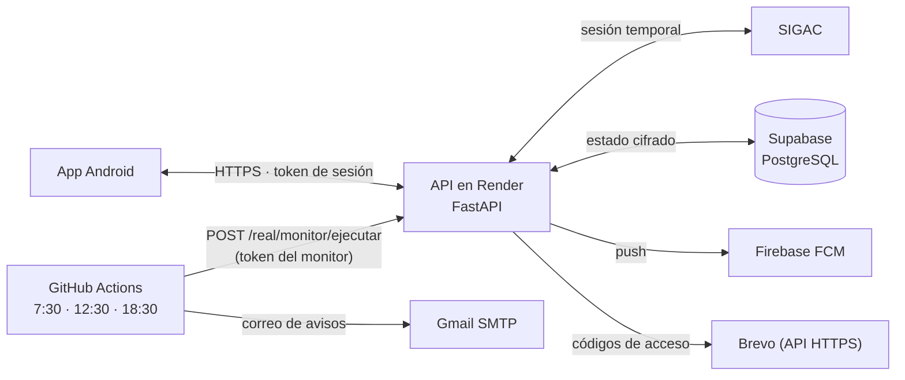

# Despliegue y operación de Tinotify

Guía operativa del servicio en producción: qué piezas lo forman, cómo se configuran, cómo se despliega una versión, cómo se verifica y qué hacer
cuando algo falla. Para publicar la app Android, ver [lanzamiento](lanzamiento.md). Para el modelo de cuentas, ver [multiusuario](multiusuario.md).

> **Regla de oro:** los secretos (claves, tokens, contraseñas, archivos de credenciales) viven **solo** en los paneles de Render, Supabase,
> GitHub, Firebase y Brevo. Nunca en el repositorio, en capturas ni en el chat.

## 1. Vista general



| Pieza | Para qué sirve | Dónde se administra |
| --- | --- | --- |
| **API (Render)** | Lee SIGAC por cada persona, compara con lo guardado, guarda el estado cifrado y atiende a la app | Panel de Render |
| **Base de datos (Supabase)** | Esquema `tinotify_real`: cuentas, estado de seguimiento y avisos (solo datos cifrados o huellas con clave) | SQL Editor de Supabase |
| **Revisiones programadas (GitHub Actions)** | Dispara la revisión tres veces al día, envía los correos de aviso y mantiene despierto el servicio en horario laboral | Pestaña *Actions* del repositorio |
| **Notificaciones push (Firebase)** | Avisos al teléfono | Consola de Firebase |
| **Correo de códigos (Brevo)** | Envía los códigos de acceso (Render gratuito bloquea el SMTP saliente) | Panel de Brevo |
| **APK (GitHub Releases)** | Distribución de la app, compilada por GitHub Actions | Pestaña *Releases* |

## 2. Servicio en Render

Servicio web `tinotify-api` (plan gratuito). El panel manda; [`render.yaml`](../render.yaml) documenta los valores esperados.

| Ajuste | Valor |
| --- | --- |
| Repositorio / rama | `JuanMa1015/Tinotify` · **`main`** |
| Root Directory | `backend` |
| Runtime | Python 3 (`PYTHON_VERSION=3.11.18`) |
| Build Command | `python -m pip install --require-hashes --only-binary=:all: -r requirements.txt -r requirements-build.txt && python scripts/install_local.py && python -m pip check` |
| Start Command | `python -m uvicorn tinotify.real_remoto.app:crear_app --factory --host 0.0.0.0 --port "$PORT" --workers 1 --no-proxy-headers --no-access-log` |
| Health Check Path | `/health` |
| Auto-Deploy | *On Commit* (o *Off* si prefieres desplegar a mano) |
| Build Filters → Included Paths | `backend/**` (los cambios de la app o de la documentación no reinician el servicio) |

Notas:
- Un solo *worker*: el estado de sesión de SIGAC vive en memoria y solo debe haber un acceso a la vez.
- **No ligar el servicio a un Blueprint**: el `render.yaml` es una referencia, no la fuente de verdad.
- El plan gratuito **duerme tras 15 minutos sin tráfico** (el primer acceso tarda hasta un minuto) y ofrece 750 horas al mes por espacio de
  trabajo. El flujo `mantener-despierto` lo mantiene despierto de 8:00 a 17:59 (hora de Bogotá), unas 300 horas al mes.

### 2.1 Variables de entorno

Todas llevan el prefijo `TINOTIFY_RR_`. **Una variable desconocida impide el arranque** (el log da solo su nombre), por eso las variables de una
función nueva se añaden **después** de desplegar el código que las reconoce (ver §6).

| Variable | Obligatoria | Valor / descripción |
| --- | --- | --- |
| `MODO` | Sí | `remoto` |
| `TLS` | Sí | `proxy` (el TLS termina en el proxy de Render) |
| `PROXIES_CONFIABLES` | Con `TLS=proxy` | `privadas` (o un rango CIDR ≥ /24 si el log muestra `transporte_rechazado`) |
| `TOKEN` | Sí | **Secreto.** Código de acceso del propietario (≥ 32 caracteres) |
| `ACREDITACION_FILE` | Sí | `/etc/secrets/acreditacion_sigac.json` (Secret File) |
| `REFERENCIA_FILE` | Sí | `/etc/secrets/referencia_portable.json` (Secret File) |
| `PG_HOST`, `PG_PORT`, `PG_DBNAME` | Sí | Pooler **de sesión** de Supabase (puerto 5432) |
| `PG_USER` | Sí | `tinotify_real_login.<ref-del-proyecto>` (login restringido, no el administrador) |
| `PG_PASSWORD` | Sí | **Secreto.** Contraseña de ese login |
| `PG_CA_FILE` | Sí | `/etc/secrets/supabase-ca.crt` (Secret File; TLS `verify-full`) |
| `CLAVE_CIFRADO` | Sí | **Secreto.** 32 bytes en base64: llave AES-256-GCM de credenciales, expedientes, fichas y correos. **Si se pierde, no se puede descifrar nada; guarda una copia fuera de Render** |
| `MONITOR_TOKEN` | Sí | **Secreto.** Token de GitHub Actions (distinto del `TOKEN`) |
| `CUENTAS` | Para cuentas de usuario | `1` activa `/auth/*` y `/admin/*` |
| `FCM_CUENTA_SERVICIO` | Para push | Ruta del Secret File con la cuenta de servicio de Firebase |
| `BREVO_CLAVE` | Para códigos por correo | **Secreto.** Clave de API de Brevo (`xkeysib-…`). Requiere `CUENTAS=1` |
| `BREVO_REMITENTE` | Con `BREVO_CLAVE` | Correo remitente **verificado** en Brevo |
| `TIPO`, `TOTAL_CASOS`, `TTL_MIN`, `MAX_LOGINS`, `VENTANA_LOGIN_MIN` | No | Ajustes finos del acceso a SIGAC (por defecto `2`, sin total, 20, 3 y 15) |

**Prohibidas** (el servicio no arranca): `TINOTIFY_SR_*`, `TINOTIFY_REAL_*`, `SIGAC_*`, `SUPABASE*`, `PG*` sin prefijo y `DATABASE_URL`.

### 2.2 Secret Files

`acreditacion_sigac.json`, `referencia_portable.json`, `supabase-ca.crt` y el JSON de la cuenta de servicio de Firebase. Quedan en `/etc/secrets/`.

## 3. Base de datos (Supabase)

Esquema `tinotify_real`, con acceso cerrado: RLS forzado en todas las tablas, sin permisos para `anon`, `authenticated` ni `service_role`, y la
Data API sin exponerlo. La API entra con un login restringido (`tinotify_real_login`, miembro de `tinotify_real_app`) con los privilegios mínimos.
Las migraciones viven en [`supabase/propuestas/`](../supabase/propuestas) y se aplican **a mano** en el *SQL Editor*, en este orden. Cada una es una
sola transacción (si algo falla no queda nada a medias) y tiene su `_down.sql` de reversión.

| # | Migración | Qué añade |
| --- | --- | --- |
| 1 | `20261117000000_crear_almacen_real` | Credenciales cifradas, estado y huellas de expedientes, avisos, ejecuciones, dispositivos |
| 2 | `20261118000000_crear_cuentas_real` | Usuarios, invitaciones y sesiones |
| 3 | `20261118010000_crear_expedientes_real` | Listado de expedientes cifrado |
| 4 | `20261118020000_estado_canales_avisos` | Estado de entrega por push y por correo |
| 5 | `20261118030000_datos_por_usuario` | Datos y credenciales por usuario |
| 6 | `20261118040000_correo_de_aviso` | Correo cifrado del usuario para los avisos |
| 7 | `20261118050000_novedades` | Fichas cifradas de las actuaciones nuevas (90 días) |
| 8 | `20261118060000_recuperacion_clave` | Códigos de acceso de un solo uso (solo su hash) |
| 9 | `20261118070000_admin_usuarios` | Permisos para el panel de administración |

Primera vez: tras la migración 1, crea el login restringido **tú mismo**, sin escribir la contraseña en ningún sitio compartido:

```sql
CREATE ROLE tinotify_real_login LOGIN INHERIT;
GRANT tinotify_real_app TO tinotify_real_login;
-- En psql:  \password tinotify_real_login
```

Comprobación (debe listar las tablas con RLS forzado):

```sql
SELECT c.relname, c.relrowsecurity, c.relforcerowsecurity
FROM pg_class c JOIN pg_namespace n ON n.oid = c.relnamespace
WHERE n.nspname = 'tinotify_real' AND c.relkind = 'r' ORDER BY 1;
```

**Validación local** (sin tocar Supabase): `bash supabase/checks/validar_cuentas_real_python.sh` levanta un PostgreSQL 17 desechable en Docker,
aplica cada migración (alta, baja y alta de nuevo) y ejecuta las pruebas contra la base real. Si el cambio toca la base, se corre antes del PR.

## 4. Automatización (GitHub Actions)

| Flujo | Cuándo corre | Qué hace |
| --- | --- | --- |
| `monitor-real` | 7:30, 12:30 y 18:30 (Bogotá) y a mano | Dispara la revisión de cada persona, envía los correos de aviso y confirma su entrega |
| `mantener-despierto` | Cada 10 min, de 8:00 a 17:59 (Bogotá) | `GET /health` para que Render no duerma |
| `apk-release` | Con una etiqueta `vX.Y.Z` o a mano | Compila, firma y publica el APK ([lanzamiento](lanzamiento.md)) |
| `backend-tests` | En cada PR y push a `main` | Pruebas del backend en Linux y Windows |
| `referencia-pg1711` | En los PR que modifican ese mismo flujo | Prueba de referencia del esquema sintético contra PostgreSQL 17.11 |

Configuración en *Settings → Secrets and variables → Actions*:

| Nombre | Tipo | Usa | Descripción |
| --- | --- | --- | --- |
| `TINOTIFY_URL` | Variable | `monitor-real`, `mantener-despierto` | `https://tinotify.onrender.com` |
| `TINOTIFY_CORREO_ACTIVO` | Variable | `monitor-real` | `1` para enviar correos de aviso |
| `TINOTIFY_MONITOR_TOKEN` | Secreto | `monitor-real` | Igual a `MONITOR_TOKEN` de Render |
| `TINOTIFY_SMTP_USUARIO`, `TINOTIFY_SMTP_CLAVE` | Secretos | `monitor-real` | Cuenta de Gmail y su **contraseña de aplicación** para los correos de aviso |
| `TINOTIFY_CORREO_DESTINO` | Secreto | `monitor-real` | Correo de aviso del propietario (opcional) |
| `ANDROID_KEYSTORE_BASE64`, `ANDROID_KEYSTORE_PASSWORD`, `ANDROID_KEY_ALIAS`, `ANDROID_KEY_PASSWORD`, `GOOGLE_SERVICES_JSON` | Secretos | `apk-release` | Ver [lanzamiento](lanzamiento.md) |

GitHub puede retrasar los cron unos minutos. Si una revisión programada no se hace, la app lo muestra en Inicio como **«Revisión atrasada»**.

## 5. Servicios externos

**Brevo** (códigos de acceso). Crea la cuenta, **verifica el correo remitente** (*Senders*), genera una clave de API (*SMTP & API → API Keys*) y
**desactiva el bloqueo de IP** (*Security → Authorised IPs*): las IP de Render cambian y, bloqueadas, Brevo responde 401. Plan gratuito: 300 correos
al día. La clave de API, no la contraseña SMTP, es la que usa la aplicación. Para comprobarlo: en la app, como propietario, *Ajustes → Mi cuenta → Enviar
correo de prueba*; si falla, muestra el motivo exacto que devuelve Brevo. Con un dominio propio verificado en Brevo los correos mejoran su
reputación y dejan de salir de una dirección `brevosend.com`.

**Firebase (FCM)**. Un proyecto con una app Android `com.tinotify.app`. La *cuenta de servicio* (rol de Firebase Cloud Messaging) va a Render como
Secret File; el `google-services.json` va como secreto de GitHub Actions para compilar la app. Ninguno de los dos va al repositorio.

## 6. Desplegar una versión del backend

1. **PR a `main`**: se ejecutan `backend-tests` (pytest en Linux y Windows) y el análisis de Sonar. No se fusiona en rojo.
2. **Si el PR trae una migración**, aplícala en Supabase **antes** de desplegar (son aditivas y retrocompatibles).
3. **Fusionar**: con Auto-Deploy *On Commit* y el filtro `backend/**`, Render despliega solo; si lo tienes en *Off*, pulsa *Manual Deploy → Deploy latest commit*.
4. **Si el cambio trae variables de entorno nuevas**, añádelas **después** de que ese despliegue esté *Live*. Antes, el servicio rechaza la variable
   desconocida y **no arranca** (`opcion_desconocida`).
5. **Verificar** (§7).

## 7. Verificación

```powershell
.\backend\.venv\Scripts\python.exe -B backend\scripts\verificar_remoto_real.py --url https://tinotify.onrender.com
```

Esperado sin token: `GET /health` → `{"status":"ok"}`, `/real/expedientes` y `/real/monitor/estado` → 401 y veredicto `ok`. Una ruta nueva que responde
**404** en lugar de 401/422 indica que Render sigue con el código anterior. Ninguna de estas comprobaciones llega a SIGAC.

## 8. Primer arranque de las cuentas

1. Con `CUENTAS=1`, `BREVO_*` configurado y las migraciones aplicadas, abre la app → **Acceso del propietario** (solo el código del servidor).
2. En *Administración* pulsa **Enviar correo de prueba** (Ajustes → Mi cuenta) para comprobar Brevo y luego **Crear invitación**.
3. Regístrate con tu correo y conviértete en administrador (una sola vez; solo es seguro si esa es la única cuenta):

   ```sql
   UPDATE tinotify_real.usuarios SET es_admin = true
   WHERE id = (SELECT id FROM tinotify_real.usuarios ORDER BY consentimiento_en DESC LIMIT 1);
   ```

4. Desde el panel invita a las demás personas; cada una se registra con su propio correo, verifica el código y conecta su SIGAC.

## 9. Problemas frecuentes

| Síntoma | Causa probable | Qué hacer |
| --- | --- | --- |
| El servicio no arranca: `opcion_desconocida: TINOTIFY_RR_…` | Variable añadida antes de desplegar el código que la reconoce | Desplegar primero la versión nueva (o retirar la variable) |
| `fcm_cuenta_ausente_o_invalida` | La ruta del Secret File de Firebase no coincide o el JSON no es válido | Corregir el nombre del archivo en `FCM_CUENTA_SERVICIO` |
| Una ruta nueva da 404 | Render no ha desplegado el último commit | Revisar *Deploys*; si hace falta, *Deploy latest commit* |
| El código de acceso no llega | Brevo bloquea la IP, remitente sin verificar o cuenta sin activar | *Enviar correo de prueba* y leer el motivo; revisar *Authorised IPs* y *Senders* |
| La app dice que no hay conexión al abrir | El servicio dormía | Esperar hasta un minuto; fuera de 8:00–17:59 es normal |
| «Revisión atrasada» en Inicio | GitHub no ejecutó el cron, o falló la revisión | Mirar *Actions → monitor-real* y, si hace falta, *Run workflow* |
| 403 con `transporte_rechazado par=<ip>` en el log | El proxy de Render está fuera de `PROXIES_CONFIABLES` | Fijar ese rango CIDR (≥ /24); no se desactiva la validación HTTPS |
| Tres errores de clave en SIGAC | SIGAC bloquea el acceso 15 minutos | Esperar; la persona actualiza su clave desde la app |
| `503 Almacen no disponible` | Supabase inaccesible o credenciales del login restringido incorrectas | Revisar `PG_*` y el estado de Supabase |

## 10. Recuperación (rollback)

- **Código**: en Render, *Deploys → Rollback* al despliegue anterior. Como las migraciones son aditivas, el código previo sigue funcionando con el esquema nuevo.
- **Migración**: ejecutar su `_down.sql` (borra solo lo que esa migración añadió). Hacerlo **después** de volver al código anterior.
- **Variable nueva que impide el arranque**: retirarla del panel y volver a desplegar.
- **App**: publicar una versión nueva; el APK anterior sigue disponible en su release.

## 11. Seguridad y secretos

| Secreto | Vive en | Si se filtra o se pierde |
| --- | --- | --- |
| `TOKEN`, `MONITOR_TOKEN` | Render y (el segundo) GitHub | Generar uno nuevo y actualizar ambos sitios |
| `CLAVE_CIFRADO` | Render (y una copia privada tuya) | **Perdida: los datos cifrados quedan ilegibles.** Filtrada: rotar y volver a cifrar |
| `PG_PASSWORD` | Render | `\password tinotify_real_login` y actualizar Render |
| `BREVO_CLAVE` | Render | Revocar en Brevo y crear otra |
| Cuenta de servicio de Firebase | Render (Secret File) | Revocar la clave en Firebase y subir otra |
| Clave de firma de la app | GitHub (secreto) y copia privada | **Perdida: no se pueden publicar actualizaciones;** las personas deben reinstalar |
| Credenciales SIGAC de las personas | Supabase, **cifradas** | Se borran desde el panel de administración o por la propia persona |

El servicio nunca registra credenciales, correos, códigos ni contenido de actuaciones. Más detalle en [seguridad](security.md) y en la
[política de tratamiento de datos](legal/politica-tratamiento-datos.md).

## 12. Historial

El servicio nació con un backend sintético desplegado desde `main` y pasó a un backend real desde una rama dedicada (`deploy/real-remoto`) con una
revisión previa de lo publicado. Hoy se despliega directamente desde `main` (el repositorio es público y el servicio solo usa `backend/`). La rama
`deploy/real-remoto` queda sin uso y puede borrarse. El código del backend sintético sigue en el repositorio, pero el servicio no lo carga.
